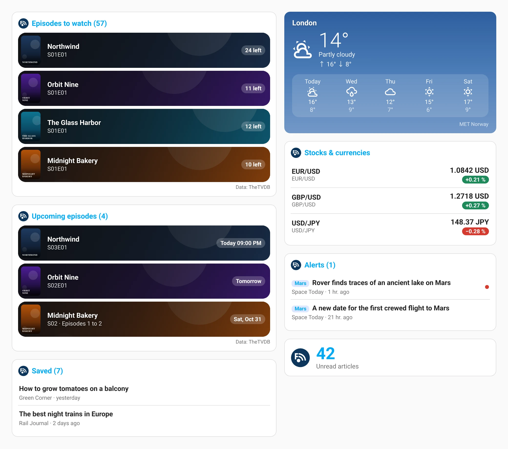

# Feedrion for Home Assistant

A [Home Assistant](https://www.home-assistant.io) integration for
[Feedrion](https://feedrion.com): your feeds, your TV shows, your cities'
weather, your currencies and your stocks, as entities, events and actions.



**Requires Feedrion Premium.** A connected account that is not Premium shows a
repair notice and its sensors go unavailable until it is.

## What you get

| Entity | What it shows |
|--------|---------------|
| `sensor.feedrion_unread_articles`, `…_saved_articles`, `…_starred_articles`, `…_unseen_alerts` | Counters |
| `sensor.feedrion_<folder>_unread` | One per folder |
| `sensor.feedrion_<feed>_unread` | One per feed you pick in the options (50 at most) |
| `sensor.feedrion_latest_articles` | The newest unread articles (titles, links, images) in its attributes |
| `sensor.feedrion_episodes_to_watch`, `sensor.feedrion_next_episode` | TV shows extension |
| `calendar.feedrion_upcoming_episodes` | Announced episodes (timed when the broadcast hour is known) |
| `todo.feedrion_saved`, `todo.feedrion_to_watch` | Check an article off = read and out of Saved; check an episode off = watched (reaches Trakt and Simkl too). Add a link to Saved by typing it. |
| `weather.feedrion_<city>` | Each city of the Weather extension, with daily and hourly forecasts (MET Norway, CC BY 4.0) |
| `sensor.feedrion_<pair>` | Each currency pair of the Stocks & currencies extension |
| `sensor.feedrion_<stock>` | My stocks, **quoted by Home Assistant itself with your own key** (see below) |
| `sensor.feedrion_ai_articles_this_month` | AI option usage |

### Events

- `feedrion_new_article` — a new article in one of the feeds you picked.
- `feedrion_alert` — a keyword alert matched (`keyword` in the data).

Both carry `article_id`, `feed_id`, `feed`, `title`, `masked`, `url`,
`image_url`, `published_at`. A title masked by anti-spoil stays masked.
Connecting or restarting never fires a backlog.

### Actions

`feedrion.mark_read`, `feedrion.mark_all_read`, `feedrion.save_url`,
`feedrion.mark_episode_watched`, and `feedrion.briefing`, which returns the
newest unread headlines as one text — ready for `tts.speak`:

```yaml
- action: feedrion.briefing
  data: { limit: 5 }
  response_variable: briefing
- action: tts.speak
  target: { entity_id: tts.home_assistant_cloud }
  data:
    media_player_entity_id: media_player.kitchen
    message: "{{ briefing.text }}"
```

## Cards

The integration ships five dashboard cards drawn like the Feedrion phone
widgets. They are loaded automatically — nothing to add under Dashboards ▸
Resources — and appear in the card picker as "Feedrion · …". They only read
the entities above: a card never calls Feedrion.

| Card | Shows |
|------|-------|
| `custom:feedrion-tv-card` | Episodes to watch (`mode: to_watch`) or upcoming (`mode: upcoming`): the show's background and poster behind each row, episodes left or air date, one show's episodes of the same day grouped |
| `custom:feedrion-weather-card` | A `weather.feedrion_…` city on a sky that follows the weather, ↑ max ↓ min, the next days (or hours) |
| `custom:feedrion-markets-card` | Currency pairs and My stocks, price and change; `rotate: true` turns one at a time like the phone row |
| `custom:feedrion-articles-card` | The newest unread articles, with images; anti-spoil titles stay masked |
| `custom:feedrion-unread-card` | One counter (unread by default, any Feedrion sensor with `entity`) |

```yaml
type: custom:feedrion-tv-card
mode: to_watch          # or upcoming
max_items: 6
show_set_aside: false   # set-aside shows are left out, like the widget
show_watched_button: false  # two taps mark the episode watched (reaches Trakt / Simkl)
```

```yaml
type: custom:feedrion-weather-card
entity: weather.feedrion_orleans
forecast: daily         # hourly or none
forecast_items: 5
```

The cards follow Home Assistant's language (20 languages, English otherwise).
A row of the TV card opens the show in Feedrion. The TheTVDB and MET Norway
attributions are shown, as their licences require.

## My stocks

Feedrion never relays share prices: your free plan with the provider licenses
personal use, not redistribution. So the server only gives Home Assistant the
list of your symbols, and Home Assistant quotes them itself, straight from the
provider, with **your** key (Twelve Data, Alpha Vantage or EODHD — options of
the integration). The key stays in Home Assistant. At most half of the key's
daily allowance is spent here; your phone spends the rest.

## Pictures

The pictures in `docs/images/` are drawn from invented data (shows, posters
and prices that exist nowhere) by the real card module, one per language:

```bash
cd scripts/screenshots
npm install && npx playwright install chromium
./fetch-fonts.sh     # optional, the fonts every script renders with
node render.mjs      # or: node render.mjs en fr
```

## Install

1. HACS ▸ ⋮ ▸ Custom repositories ▸ `https://github.com/max28/feedrion-homeassistant`,
   category *Integration*. Install **Feedrion**, restart Home Assistant.
2. Settings ▸ Devices & services ▸ Add integration ▸ **Feedrion**.
3. A code appears. In the Feedrion app, open Settings ▸ Integrations ▸
   Connected devices and type it. The app shows what is asking before you
   approve. No password ever reaches Home Assistant.
4. Options: the feeds that get their own sensor and events, how many articles
   the "latest articles" sensor holds, and the provider and key for My stocks.

Removing the integration signs this Home Assistant out of Feedrion; the app can
also disconnect it (Home Assistant then asks to pair again).

## Privacy

Home Assistant calls Feedrion (https only) and, for My stocks only, the
quote provider you chose. Feedrion never connects to your Home Assistant.

## Verify a download

```bash
cosign verify-blob feedrion.zip --bundle feedrion.zip.sigstore.json \
  --certificate-identity-regexp '^https://github.com/max28/feedrion-homeassistant/\.github/workflows/release\.yml@refs/heads/main$' \
  --certificate-oidc-issuer https://token.actions.githubusercontent.com
```

## Develop

```bash
python -m pip install -r requirements_test.txt ruff==0.14.0
ruff check custom_components tests scripts
python -m pytest -q
node --test tests/js/*.test.cjs
```

## License

[Apache-2.0](LICENSE). Feedrion is a trademark of its owner; this licence
covers the code in this repository, not the Feedrion service or its name.
